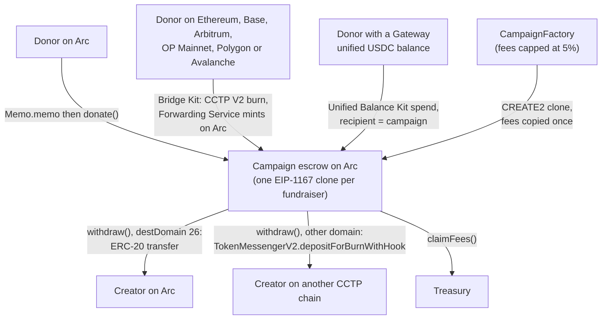

# Fundit

Fundit is a crowdfunding app on Arc, Circle's stablecoin-native blockchain. Each fundraiser is its own
escrow contract that holds USDC or EURC. Only the creator can withdraw, and anyone can read every
inflow and outflow on chain. Fundit has no backend, no database and no server that holds keys.

> **Status: pre-launch.** The contracts are not deployed to Arc mainnet yet. The addresses table below
> is a placeholder. See [Status and roadmap](#status-and-roadmap).

## What Fundit is

- A static React app (planned for `fundit.xyz` on Cloudflare Pages) and two Solidity contracts on
  Arc mainnet (chain ID `5042`, CCTP domain `26`).
- `CampaignFactory` deploys one `Campaign` per fundraiser as an EIP-1167 clone with CREATE2.
- Each `Campaign` holds exactly one token, USDC or EURC, chosen by the creator at creation.
- The contracts are immutable. There are no proxies and no upgrade path.
- Funding rule: the creator keeps what they raise. There are no refunds and no deadlines.

## How it works

1. **Create.** The creator calls `createCampaign(token, goal, backup, meta)` on the factory. The
   factory deploys the campaign and copies the current fees into it. Those fees never change for
   that campaign.
2. **Donate.** A donor on Arc approves the campaign and calls `donate(amount, tip, message)`. From a
   regular wallet (an EOA), the app sends the call through Arc Memo, which keeps the donor as
   `msg.sender`.
3. **Settle inflows from other chains.** USDC that reaches the campaign by a CCTP or Gateway mint, or
   by a plain transfer, is "unaccounted". `settle()` books it as a donation and charges the same
   donation fee. Anyone can call `settle()`, and `donate`, `withdraw` and `claimFees` call it first.
4. **Withdraw.** The creator calls `withdraw(amount, destDomain, recipient, maxFee,
   minFinalityThreshold, hookData)`. On Arc (domain `26`) it is a plain ERC-20 transfer. For any
   other CCTP domain, the campaign burns USDC through `TokenMessengerV2` with the CCTP Forwarding
   Service hook, and Circle submits the mint on the destination chain.
5. **Claim fees.** Fees and tips stay in the campaign until anyone calls `claimFees()`, which sends
   them to the factory's current treasury.

### Fees

| Fee | Launch value | Cap in code | When it is set |
| --- | --- | --- | --- |
| Donation fee | 1% (`DONATION_FEE_BPS=100`) | 5% (`MAX_FEE_BPS = 500`) | Copied into each campaign at creation |
| Withdrawal fee | 1% (`WITHDRAW_FEE_BPS=100`) | 5% (`MAX_FEE_BPS = 500`) | Copied into each campaign at creation |
| Tip | Chosen by the donor, can be zero | None | Per donation |

The launch values are the planned deploy configuration. The cap is enforced in
[`CampaignFactory.sol`](contracts/src/CampaignFactory.sol#L155-L160).

## Circle and Arc products used

This list covers every product on the app's home page
([`app/src/pages/Home.tsx`](app/src/pages/Home.tsx#L33-L44)), plus Arc itself and the CCTP fees API. Two build flags decide what ships:
`VITE_CROSSCHAIN` and `VITE_PASSKEYS` ([`app/src/config.ts`](app/src/config.ts#L85-L88)). Both are
off at launch and turn on only after a live mainnet canary confirms each path.

| Product | How Fundit uses it | Code | Planned at launch |
| --- | --- | --- | --- |
| Arc | Home chain for every campaign. Gas is paid in USDC. | [`app/src/config.ts`](app/src/config.ts#L5-L7) | On |
| USDC | Campaign token, used through the ERC-20 interface with 6 decimals. | [`app/src/config.ts`](app/src/config.ts#L12-L15), [`CampaignFactory.sol`](contracts/src/CampaignFactory.sol#L105) | On |
| EURC | Campaign token. EURC campaigns take donations and pay out on Arc only. | [`app/src/config.ts`](app/src/config.ts#L12-L15), [`Create.tsx`](app/src/pages/Create.tsx#L301-L305) | On |
| Arc Memo | Routes each on-Arc donation from an EOA through `Memo.memo(target, data, memoId, memoData)`, tagged `fundit.donate.v1`. | [`app/src/lib/donate.ts`](app/src/lib/donate.ts#L37-L49) | On |
| CCTP V2 (`TokenMessengerV2`) | Creator payouts in USDC to Ethereum, Avalanche, OP Mainnet, Arbitrum, Base and Polygon. | [`Campaign.sol`](contracts/src/Campaign.sol#L217-L232), [`app/src/lib/payout.ts`](app/src/lib/payout.ts#L24-L48) | On |
| CCTP Forwarding Service | Hook data on every cross-chain payout, so Circle submits the destination mint. | [`app/src/config.ts`](app/src/config.ts#L21-L22) | On |
| CCTP V2 fees API (Iris) | Fast and Standard fee quotes with forwarding. | [`app/src/lib/iris.ts`](app/src/lib/iris.ts#L15) | On |
| Bridge Kit | Cross-chain donations: burns USDC on the donor's chain with the campaign as recipient and `useForwarder: true`. | [`app/src/lib/bridge.ts`](app/src/lib/bridge.ts#L298-L326) | Behind `VITE_CROSSCHAIN` |
| Gateway and Unified Balance Kit | Donations from a donor's unified USDC balance, minted to the campaign on Arc. | [`app/src/lib/unified.ts`](app/src/lib/unified.ts#L216-L243) | Behind `VITE_CROSSCHAIN` |
| Modular Wallets (passkeys) | Passkey smart accounts for donors and creators, with user operations sent to Circle's bundler. | [`app/src/lib/passkey.ts`](app/src/lib/passkey.ts#L193-L217) | Behind `VITE_PASSKEYS` |

Cross-chain donations, unified balance donations and passkeys are built and unit-tested with mocks.
On an Arc mainnet fork, the end-to-end suite simulates a forwarded mint (a plain USDC transfer and a
stubbed Iris response). No Bridge Kit, Gateway or Modular Wallets call has run against Arc yet. They
stay off until the live canary confirms them.

The "Planned at launch" column is the plan until the live canary confirms each path.

### Not used

Fundit sends no user operation through a paymaster: passkey accounts pay their own gas in USDC on Arc
([`passkey.ts`](app/src/lib/passkey.ts#L118-L119)). Fundit does not use Onramp Kit, Swap, StableFX,
USYC or any other Circle product not listed above.

## Architecture



The paths from donors on other chains and from Gateway are behind `VITE_CROSSCHAIN` at launch. A longer explanation is in [`docs/whitepaper.md`](docs/whitepaper.md), and a diagram page is
in [`docs/architecture.html`](docs/architecture.html).

## Trust model

Read [`contracts/SECURITY.md`](contracts/SECURITY.md) for the full model and the accepted Slither
findings. The short version:

- The factory owner can set fees (each at most 5%, for new campaigns only), set a featured campaign
  and pause the creation of new campaigns.
- The owner can set the treasury to any non-zero address. `claimFees` pays the treasury named at
  claim time, so a new treasury also receives unclaimed fees and tips from existing campaigns.
- The owner can never move, freeze or redirect any creator balance, change an existing campaign's
  fees, token or creator, pause donations or withdrawals, or upgrade any contract.
- `renounceOwnership` always reverts
  ([`CampaignFactory.sol`](contracts/src/CampaignFactory.sol#L186-L188)), so the treasury can always
  be rotated.
- Fees stay in the campaign until someone calls `claimFees()`. A broken treasury cannot block
  donations or withdrawals.
- **Creator recovery.** A creator can name an optional backup address. The backup can start a
  recovery, and after a 7-day wait (`RECOVERY_DELAY`) it becomes the creator. The creator keeps every
  power during the wait and can cancel it at any time.

## Deployed addresses

Placeholder. These rows are filled after the mainnet deploy.

| Contract | Network | Address |
| --- | --- | --- |
| `CampaignFactory` | Arc mainnet (5042) | `TBD after deploy` |
| `Campaign` implementation | Arc mainnet (5042) | `TBD after deploy` |

External contracts Fundit calls (from [`app/src/config.ts`](app/src/config.ts#L12-L19)):

| Contract | Address |
| --- | --- |
| USDC (Arc) | `0x3600000000000000000000000000000000000000` |
| EURC (Arc) | `0xbEf5f6d51CB62b58e6A8f77868681825C6fe21c1` |
| `TokenMessengerV2` | `0x28b5a0e9C621a5BadaA536219b3a228C8168cf5d` |
| Arc Memo | `0x5294E9927c3306DcBaDb03fe70b92e01cCede505` |

## Run it locally

### Contracts

Requirements: [Foundry](https://getfoundry.sh) for the offline suite, and Arc Foundry `v0.8.0-2` for the
fork suite. Install steps are in [`contracts/README.md`](contracts/README.md#install-arc-foundry).

1. Run the offline suite (unit, fuzz and invariant tests):

   ```shell
   cd contracts
   forge test
   ```

2. Run the fork suite against Arc mainnet. It only reads chain state:

   ```shell
   ARC_FORK=1 arc-forge test --match-path test/fork/ArcFork.t.sol --fork-url arc -vv
   ```

3. Run Slither:

   ```shell
   slither . --config-file slither.config.json
   ```

To simulate a deploy, follow [Simulate the deploy](contracts/README.md#simulate-the-deploy).

### App

Requirements: Node.js `>=24.15.0 <25`.

1. Install dependencies and copy the env template:

   ```shell
   cd app
   npm ci
   cp .env.example .env
   ```

2. Fill in `.env`. Every value is public. See [`app/.env.example`](app/.env.example).
3. Start the dev server, then run the type check and unit tests:

   ```shell
   npm run dev
   npm run typecheck
   npm test
   ```

### End-to-end tests

The Playwright specs drive the built app against a local Arc mainnet fork. They need Arc Foundry and
Chromium:

```shell
npx --prefix app playwright install chromium
ARC_ANVIL_BIN=~/.local/bin/arc-anvil npm --prefix app run e2e
```

See [`app/e2e/README.md`](app/e2e/README.md) for what a run does.

## Status and roadmap

### Status

- Contracts: built and tested (unit, fuzz, invariant, Arc mainnet fork). Not deployed.
- App: built and tested against an Arc mainnet fork. Not deployed.
- `VITE_CROSSCHAIN` and `VITE_PASSKEYS`: off until the live canary confirms each path.
- EURC: Arc only. On Arc mainnet, CCTP cannot burn EURC today
  (`depositForBurn(EURC)` reverts with "Burn token not supported" on a fork for domains 0, 1, 6 and
  14). The factory's EURC payout list is fixed at deploy and starts empty.

### Roadmap

- **V2: card donations.** Donors pay by card through Circle's Onramp Kit, with USDC delivered to the
  campaign.
- **V2: agent features.** Ideas only. One example is an agent that drafts a campaign page or answers
  donor questions from on-chain data. Agents never hold keys that control money.

## License

MIT. See [`LICENSE`](LICENSE).
