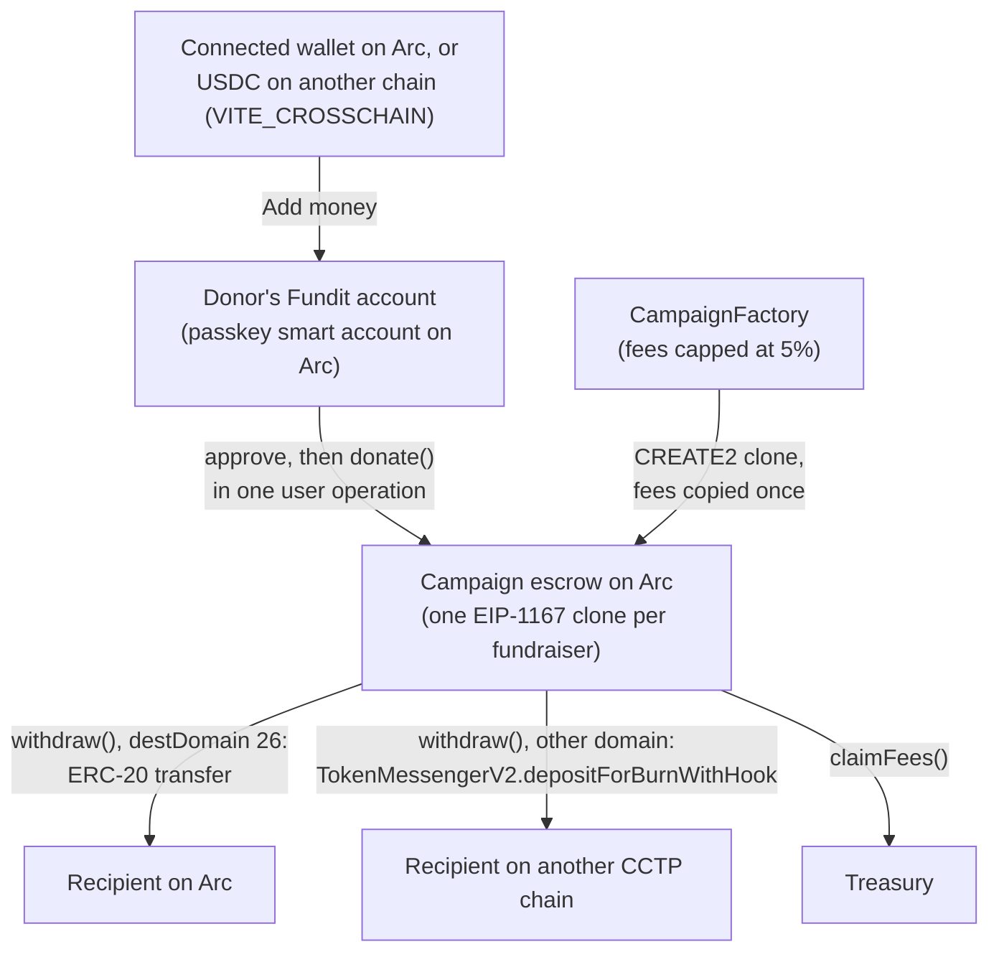

# Fundit

Fundit is a crowdfunding app on Arc, Circle's stablecoin-native blockchain. Each fundraiser is its own
escrow contract that holds USDC or EURC. Only the creator can withdraw, and anyone can read every
inflow and outflow on chain. Fundit has no backend, no database and no server that holds keys.

## What Fundit is

- A static React app, live at [fundit.fun](https://fundit.fun) on Cloudflare Pages, and two Solidity
  contracts deployed on Arc mainnet (chain ID `5042`, CCTP domain `26`). See
  [Deployed addresses](#deployed-addresses).
- fundit.fun runs on Arc mainnet. Passkey sign-in ships with the next release, once the `fundit.fun`
  Circle client key is set. The rest of this README describes that release.
- People sign in with a Fundit account only. A Fundit account is a passkey smart account from Circle
  Modular Wallets. There is no wallet sign-in.
- `CampaignFactory` deploys one `Campaign` per fundraiser as an EIP-1167 clone with CREATE2.
- Each `Campaign` holds exactly one token, USDC or EURC, chosen by the creator at creation.
- The contracts are immutable. There are no proxies and no upgrade path.
- Funding rule: the creator keeps what they raise. There are no refunds and no deadlines.

## How it works

1. **Create.** The creator calls `createCampaign(token, goal, backup, meta)` on the factory from their
   Fundit account. The factory deploys the campaign and copies the current fees into it. Those fees
   never change for that campaign.
2. **Donate.** The donor's Fundit account approves the campaign and calls `donate(amount, tip,
   message)` in one user operation. The donor is `msg.sender`.
3. **Settle other inflows.** USDC that reaches the campaign by a CCTP mint or by a plain transfer is
   "unaccounted". `settle()` books it as a donation and charges the same donation fee. Anyone can
   call `settle()`, and `donate`, `withdraw` and `claimFees` call it first.
4. **Withdraw.** The creator calls `withdraw(amount, destDomain, recipient, maxFee,
   minFinalityThreshold, hookData)`. On Arc (domain `26`) it is a plain ERC-20 transfer. For any
   other CCTP domain, the campaign burns USDC through `TokenMessengerV2` with the CCTP Forwarding
   Service hook, and Circle submits the mint on the destination chain.
5. **Claim fees.** Fees and tips stay in the campaign until anyone calls `claimFees()`, which sends
   them to the factory's current treasury.

### Fees

| Fee | Deployed value | Cap in code | When it is set |
| --- | --- | --- | --- |
| Donation fee | 1% (`donationFeeBps = 100`) | 5% (`MAX_FEE_BPS = 500`) | Copied into each campaign at creation |
| Withdrawal fee | 1% (`withdrawFeeBps = 100`) | 5% (`MAX_FEE_BPS = 500`) | Copied into each campaign at creation |
| Tip | Chosen by the donor, can be zero | None | Per donation |

The deployed values are the constructor arguments in
[`contracts/deployments/arc-mainnet.json`](contracts/deployments/arc-mainnet.json). The cap is enforced in
[`CampaignFactory.sol`](contracts/src/CampaignFactory.sol#L155-L160).

## Circle and Arc products used

One build flag changes what ships: `VITE_CROSSCHAIN` turns on **Add money** from another chain. It is off
by default ([`app/src/config.ts`](app/src/config.ts)).

| Product | How Fundit uses it | Code | Default build |
| --- | --- | --- | --- |
| Arc | Home chain for every campaign. Gas is paid in USDC. | [`app/src/config.ts`](app/src/config.ts) | On |
| USDC | Campaign token, used through the ERC-20 interface with 6 decimals. | [`app/src/config.ts`](app/src/config.ts), [`CampaignFactory.sol`](contracts/src/CampaignFactory.sol#L105) | On |
| EURC | Campaign token. EURC campaigns take donations and pay out on Arc only. | [`app/src/config.ts`](app/src/config.ts), [`Create.tsx`](app/src/pages/Create.tsx) | On |
| Modular Wallets (passkeys) | The Fundit account: a passkey smart account. Every action is a user operation sent to Circle's bundler. | [`app/src/lib/passkey.ts`](app/src/lib/passkey.ts) | On |
| CCTP V2 (`TokenMessengerV2`) | Creator payouts, and **Send money out** from a Fundit account, in USDC to the CCTP chains in `CCTP_CHAINS`. | [`Campaign.sol`](contracts/src/Campaign.sol#L217-L231), [`app/src/lib/payout.ts`](app/src/lib/payout.ts), [`app/src/lib/accountWithdraw.ts`](app/src/lib/accountWithdraw.ts) | On |
| CCTP Forwarding Service | Hook data on every cross-chain payout and send, so Circle submits the destination mint. | [`app/src/config.ts`](app/src/config.ts) (`FORWARD_HOOK_DATA`) | On |
| CCTP V2 fees API (Iris) | Fast and Standard fee quotes with forwarding. | [`app/src/lib/iris.ts`](app/src/lib/iris.ts) | On |
| Bridge Kit | **Add money** from another chain: burns USDC on the person's chain with their Fundit account as the recipient. | [`app/src/lib/bridge.ts`](app/src/lib/bridge.ts), [`AddMoneyPanel.tsx`](app/src/components/AddMoneyPanel.tsx) | Behind `VITE_CROSSCHAIN` |

On Arc mainnet, `CCTP_CHAINS` is Ethereum, Avalanche, OP Mainnet, Arbitrum, Base and Polygon. On Arc
testnet, it is Ethereum Sepolia and Base Sepolia.

### Not used

Fundit sends no user operation through a paymaster. A Fundit account pays its own gas in USDC on Arc.
Fundit does not use Arc Memo, Gateway, Unified Balance Kit, Onramp Kit, Swap, StableFX, USYC or any
other Circle product not listed above.

### Wallet connections

Reown (WalletConnect) appears in one place: **Add money**, where a person can connect a wallet to send
USDC or EURC into their Fundit account. Nobody signs in with a connected wallet.

## Architecture



A longer explanation is in [`docs/whitepaper.md`](docs/whitepaper.md), and a diagram page is in
[`docs/architecture.html`](docs/architecture.html).

## Trust model

Read [`contracts/SECURITY.md`](contracts/SECURITY.md) for the full model and the accepted Slither
findings. The short version:

- The factory owner can set fees (each at most 5%, for new campaigns only), set a featured campaign
  and pause the creation of new campaigns.
- The owner can set the treasury to any non-zero address. `claimFees` pays the treasury named at
  claim time, so a new treasury also receives unclaimed fees and tips from existing campaigns.
- The owner can never move, freeze or redirect any creator balance, change an existing campaign's
  fees, token or creator, pause donations or withdrawals, or upgrade any contract.
- `renounceOwnership` always reverts
  ([`CampaignFactory.sol`](contracts/src/CampaignFactory.sol#L186-L188)), so the treasury can always
  be rotated.
- Fees stay in the campaign until someone calls `claimFees()`. A broken treasury cannot block
  donations or withdrawals.
- **Creator recovery.** A creator can name an optional backup address. The backup can start a
  recovery, and after a 7-day wait (`RECOVERY_DELAY`) it becomes the creator. The creator keeps every
  power during the wait and can cancel it at any time.

## Fundit accounts (passkeys)

A Fundit account is a Circle Modular Wallets smart account on Arc. The owner signs with a passkey (a
fingerprint, face or device PIN), so no wallet app is needed. It is the only way to sign in. A
production build fails without `VITE_CIRCLE_CLIENT_KEY`. The account pays its own gas in USDC, with no
paymaster. Every action that spends USDC leaves 0.05 USDC (`PASSKEY_GAS_BUFFER`) in the account for the
network fee.

### What a person can do

- **Sign in.** **Sign in** opens a dialog with **Continue with passkey**. On the next step the person
  enters a name for a new passkey and selects **Create my Fundit account**, or selects **Sign in with a
  passkey** to use one already on the device. After a sign-in from the top bar, the app opens **Add
  money**. See [`AccountMenu.tsx`](app/src/components/AccountMenu.tsx) and
  [`PasskeyLogin.tsx`](app/src/components/PasskeyLogin.tsx).
- **Save a recovery key.** Right after sign-up, a dialog offers a recovery key: 12 words that the person
  writes down and keeps safe. The person types 3 of the words back. The account then registers the key's
  address with Circle's `registerRecoveryAddress`. The words never leave the browser. Only the derived
  address does. The account needs 0.05 USDC first, for the network fee. Until a key is saved, **My page**
  keeps asking. See [`AddBackupPasskey.tsx`](app/src/components/AddBackupPasskey.tsx).
- **Recover the account.** `/recover` takes the 12 words, creates a new passkey on this device and adds it
  as an owner with `executeRecovery`. The sign-in dialog links to it as **Lost your passkey? Recover your
  account**. See [`Recover.tsx`](app/src/pages/Recover.tsx).
- **Add money.** The **Add money** button on **My page** opens a panel. Every Add money link in the app
  opens `/me?add=1`. The **Your address** tab shows the account address and its QR code, for USDC or EURC
  sent on Arc from any wallet or exchange. The **From a wallet** tab sends from a connected wallet, shows
  which wallet is connected and has a **Disconnect** button. The app switches that wallet to Arc first and
  never sends on another chain. With `VITE_CROSSCHAIN=1`, a **From another chain** tab takes USDC from
  another chain through Bridge Kit. See [`AddMoneyPanel.tsx`](app/src/components/AddMoneyPanel.tsx).
- **Give.** The Fundit account approves the campaign and calls `donate` in one user operation. If the
  balance is too low, the **Give** panel links to **Add money**. See
  [`DonatePanel.tsx`](app/src/components/DonatePanel.tsx).
- **Send money out.** The **Send** button on **My page** opens the **Send money out** form. It sends USDC or EURC to any address on
  Arc, or USDC to another CCTP chain with the Forwarding Service, in one passkey confirmation. It refuses
  the account's own address, and any USDC amount that leaves less than 0.05 USDC behind. See
  [`AccountWithdraw.tsx`](app/src/components/AccountWithdraw.tsx).
- **Withdraw as an organiser.** **Manage** withdraws a campaign's balance on Arc, or as USDC to any chain
  in `CCTP_CHAINS`. Before a payout to another chain, the app warns that the Fundit account may not exist
  there. See [`Manage.tsx`](app/src/pages/Manage.tsx).

### Set up Circle Console

Passkeys are bound to `fundit.fun`. The WebAuthn relying party comes from the client key's domain, so a
passkey created on one domain does not work on another.

1. In Circle Console, create a client key under **Keys** > **Client Key**. Set the passkey domain and the
   allowed domain to `fundit.fun`.
2. Create a second client key for `localhost`. Use it only for development, with throwaway accounts.
3. Set `VITE_CIRCLE_CLIENT_KEY` to the key. For development, put it in `app/.env.local` with the
   `localhost` key. For production, put it in the Cloudflare Pages build variables with the `fundit.fun` key. See
   [`app/.env.example`](app/.env.example).

## Hide my name

The **Give** panel has a **Hide my name** switch. When the donor switches it on, the app puts the ASCII marker
`[anon]` (6 bytes) at the start of the message. The message limit drops from 280 bytes
(`MAX_MESSAGE_BYTES`) to 274 bytes, and the form blocks a longer message before anything is sent. Fundit
pages then show "Anonymous" in place of the donor's name, and show the message without the marker. Any
message that starts with `[anon]` counts as anonymous, whether or not the box was ticked. See
[`app/src/lib/anon.ts`](app/src/lib/anon.ts).

Hide my name hides the name on Fundit only. The gift stays public on chain. The `Donated` event
records the donor's Fundit account address, and anyone can read it on Arc.

## Deployed addresses

### Arc mainnet (chain ID `5042`)

From [`contracts/deployments/arc-mainnet.json`](contracts/deployments/arc-mainnet.json). The explorer is
`https://explorer.arc.io`.

| Contract | Address |
| --- | --- |
| `CampaignFactory` | [`0xf1b2AEF82c37fC41D254D8e06BD7780ce34617d9`](https://explorer.arc.io/address/0xf1b2AEF82c37fC41D254D8e06BD7780ce34617d9) |
| `Campaign` implementation | [`0x083CE7a68Ae418f832E12c2aB976615237e03853`](https://explorer.arc.io/address/0x083CE7a68Ae418f832E12c2aB976615237e03853) |
| Owner and treasury | [`0x3552E9c14C7b6050839009A5B160A4446a1e916D`](https://explorer.arc.io/address/0x3552E9c14C7b6050839009A5B160A4446a1e916D) |

- Deploy block: `26452579`
  ([deploy transaction](https://explorer.arc.io/tx/0x1e7f9bbc73ebbab575ee8d9a5ffd6ac67aa7ca24df0afcdc738fd590f568a8ad)).
  Set `VITE_FACTORY_DEPLOY_BLOCK` to this value.
- Source verification: both contracts are an exact match on
  [Sourcify](https://sourcify.dev/#/lookup/0xf1b2AEF82c37fC41D254D8e06BD7780ce34617d9). They are not verified
  on the Arc explorer, which blocks automated verification.

### Arc testnet (chain ID `5042002`)

From `contracts/deployments/arc-testnet.json`. The explorer is `https://explorer.testnet.arc.io`.

| Contract | Address |
| --- | --- |
| `CampaignFactory` | [`0x6890D40a9A472D0d05aDb5938D85B07059ad54ab`](https://explorer.testnet.arc.io/address/0x6890D40a9A472D0d05aDb5938D85B07059ad54ab) |
| `Campaign` implementation | [`0xC7109CAAA5375EE740b95a3DeE52c4C92A02Ba8E`](https://explorer.testnet.arc.io/address/0xC7109CAAA5375EE740b95a3DeE52c4C92A02Ba8E) |
| Owner and treasury | [`0x3552E9c14C7b6050839009A5B160A4446a1e916D`](https://explorer.testnet.arc.io/address/0x3552E9c14C7b6050839009A5B160A4446a1e916D) |

- Deploy block: `67870064` ([deploy transaction](https://explorer.testnet.arc.io/tx/0xbf0bbbbb106dbca7294a4e72a3ab1c153519b6c1269589684a45f55aaf80a728)). Set `VITE_FACTORY_DEPLOY_BLOCK` to this
  value.
- Fees: 1% on donations and 1% on withdrawals, the same as on mainnet.

### External contracts

From `NETWORKS` in [`app/src/config.ts`](app/src/config.ts):

| Contract | Arc mainnet | Arc testnet |
| --- | --- | --- |
| USDC | `0x3600000000000000000000000000000000000000` | `0x3600000000000000000000000000000000000000` |
| EURC | `0xbEf5f6d51CB62b58e6A8f77868681825C6fe21c1` | `0x89B50855Aa3bE2F677cD6303Cec089B5F319D72a` |
| `TokenMessengerV2` | `0x28b5a0e9C621a5BadaA536219b3a228C8168cf5d` | `0x8FE6B999Dc680CcFDD5Bf7EB0974218be2542DAA` |

## Run it locally

### Contracts

Requirements: [Foundry](https://getfoundry.sh) for the offline suite, and Arc Foundry `v0.8.0-2` for the
fork suite. Install steps are in [`contracts/README.md`](contracts/README.md#install-arc-foundry).

1. Run the offline suite (unit, fuzz and invariant tests):

   ```shell
   cd contracts
   forge test
   ```

2. Run the fork suite against Arc mainnet. It only reads chain state:

   ```shell
   ARC_FORK=1 arc-forge test --match-path test/fork/ArcFork.t.sol --fork-url arc -vv
   ```

3. Run Slither:

   ```shell
   slither . --config-file slither.config.json
   ```

To simulate a deploy, follow [Simulate the deploy](contracts/README.md#simulate-the-deploy).

### App

Requirements: Node.js `>=24.15.0 <25`.

1. Install dependencies and copy the env template:

   ```shell
   cd app
   npm ci
   cp .env.example .env.local
   ```

2. Fill in `.env.local`. Every value is public and ships in the bundle. See the table below. The file is
   gitignored and used only on your machine. Production builds take their values from the Cloudflare Pages
   build variables.
3. Start the dev server, then run the type check and unit tests:

   ```shell
   npm run dev
   npm run typecheck
   npm test
   ```

### Environment variables

From [`app/.env.example`](app/.env.example):

| Variable | Meaning |
| --- | --- |
| `VITE_ARC_NETWORK` | `mainnet` (the default when empty) or `testnet`. Every chain ID, token and contract address, RPC and Circle API URL comes from this value. |
| `VITE_ALLOW_TESTNET_BUILD` | Set to `1` to let a production build (`npm run build`) use `testnet`. Use it for a test site only. Never set it where the `fundit.fun` build runs. |
| `VITE_REOWN_PROJECT_ID` | Reown (WalletConnect) project ID, for connecting a wallet in **Add money**. A production build fails without it. |
| `VITE_CIRCLE_CLIENT_KEY` | Circle client key for Fundit accounts. A production build fails without it. Use the `fundit.fun` key in production and a separate `localhost` key in development. |
| `VITE_FACTORY_ADDRESS` | `CampaignFactory` on the chosen network. Set it together with `VITE_FACTORY_DEPLOY_BLOCK`. A production build fails if either is empty. |
| `VITE_FACTORY_DEPLOY_BLOCK` | The block the factory was deployed in. |
| `VITE_ARC_RPC_URL` | Arc RPC override. Leave it empty to use the network's own RPC. If you set it, it must point at the chosen network. |
| `VITE_MAINNET_RPC_URL` | Ethereum mainnet RPC. Defaults to `https://ethereum-rpc.publicnode.com`. |
| `VITE_CROSSCHAIN` | Set to `1` to offer **Add money** from another chain. Off by default. Payouts to other chains in **Manage** do not depend on it. |

If you change an RPC host, add it to `connect-src` in `app/public/_headers`.

## Test on Arc testnet

Run every end-to-end test and every test that moves money on Arc testnet, never on Arc mainnet. Testnet
tokens have no value. The unit tests use mocks, and the contract fork suite only reads Arc mainnet state. A testnet build shows a "Test network" banner, and it refuses to run on
`fundit.fun`.

1. Set the network in `app/.env.local`:

   ```shell
   VITE_ARC_NETWORK=testnet
   VITE_CIRCLE_CLIENT_KEY=<localhost-client-key>
   VITE_FACTORY_ADDRESS=<testnet-factory-address>
   VITE_FACTORY_DEPLOY_BLOCK=<testnet-deploy-block>
   ```

   The dev server and the end-to-end suite accept `testnet` as is. Keep `VITE_ALLOW_TESTNET_BUILD` out of
   this file. Set it only for a one-off build of a test site, never where the `fundit.fun` build runs:

   ```shell
   VITE_ALLOW_TESTNET_BUILD=1 npm run build
   ```

2. Fill in the factory values from [Arc testnet](#arc-testnet-chain-id-5042002):
   `VITE_FACTORY_ADDRESS=0x6890D40a9A472D0d05aDb5938D85B07059ad54ab` and `VITE_FACTORY_DEPLOY_BLOCK=67870064`.
   The app refuses the other network's factory, and a deploy block that does not match a known factory.
3. Get testnet USDC from the [Circle faucet](https://faucet.circle.com) and send it to your Fundit
   account address in **Add money**.

### End-to-end tests

The Playwright suite runs on Arc testnet with a virtual passkey. It signs up, saves a recovery key, adds
money from a funder account, creates a Fundit, gives anonymously, withdraws and sends money out. A run
costs the funder about 2.2 to 2.5 testnet USDC. Most of that is gas: Circle's bundler prices each user
operation at about 730 to 900 gwei, against an Arc base fee of about 20 gwei, and the first operation also
deploys the account. See [`app/e2e/README.md`](app/e2e/README.md).

## Status and roadmap

### Status

- Contracts: deployed on Arc mainnet and verified on Sourcify. See
  [Deployed addresses](#deployed-addresses). Tested with unit, fuzz, invariant and Arc mainnet fork tests.
- Contracts on Arc testnet: deployed at block `67870064`. See
  [Arc testnet](#arc-testnet-chain-id-5042002). The end-to-end suite runs on them.
- App: live at [fundit.fun](https://fundit.fun) on Arc mainnet. Passkey-only sign-in (this branch)
  ships with the next release, once the `fundit.fun` Circle client key is set. Unit tests run with mocks.
- `VITE_CROSSCHAIN`: off by default.
- EURC: Arc only. On Arc mainnet, CCTP cannot burn EURC today
  (`depositForBurn(EURC)` reverts with "Burn token not supported" on a fork for domains 0, 1, 6 and
  14). The factory's EURC payout list is fixed at deploy and is empty
  (`eurcPayoutDomains` in [`arc-mainnet.json`](contracts/deployments/arc-mainnet.json)).

### Roadmap

- **Card donations.** Donors pay by card through Circle's Onramp Kit, with USDC delivered to the
  campaign.
- **Private giving.** Gifts through a zero-knowledge (ZK) pool, so the donor's address is not linked to
  the gift on chain. Hide my name does not do this today.
- **Giving agent.** An idea for a later version. It will connect wallets through Reown. Agents never
  hold keys that control money.

## License

MIT. See [`LICENSE`](LICENSE).
